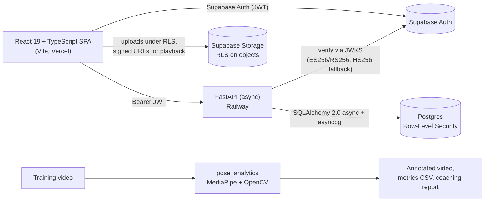

# Padel Coach: training platform with AI video analysis

[](https://github.com/thanzap/padel_coach/actions/workflows/ci.yml)


A platform for padel coaches and their players. Coaches publish weekly availability, build training programs and
run sessions. Players find a coach, book a slot and get their exercises, recordings and scores in one place.
A **computer-vision module** turns a training video into stance metrics, a shot-by-shot breakdown and a
plain-language coaching report.

> 🎥 _Demo GIF of the pose overlay: `docs/pose-demo.gif`_ · 🌐 _Live demo: add link_

---

## Features

**Coaching platform**
- Coach and player roles with profile onboarding and club/location
- Weekly recurring availability, one-off blocks, and conflict-free booking: free time = weekly rules
  − confirmed sessions − pending requests, computed in the coach's time zone and safe across daylight-saving changes
- Session requests → coach confirmation → planned / in-progress / done lifecycle
- Training programs with ordered exercises, copied into each session and scored per exercise
- Exercise video uploads (50 MB cap) to private storage, visible only to the session's coach and player
- Dashboards for upcoming and past sessions on both sides

**Pose analytics** ([`pose_analytics/`](pose_analytics/))
- MediaPipe Pose tracking of 33 body landmarks per frame
- Per-frame knee angle, stance width (ankles ÷ hips), trunk lean and lateral balance, combined into a 0–100
  ready-stance score calibrated to coaching guidance
- Swing detection from racket-hand speed peaks (adaptive percentile threshold, minimum gap between shots)
- Shot classification: forehand/backhand × contact height (low/waist/high), overheads
  (bandeja/víbora vs smash) via elbow extension and jump detection
- Outputs: annotated video with skeleton and live metrics, `frame_metrics.csv`, `swing_events.csv`, and a
  `summary.json` with a coaching report (*observation → why it matters → how to fix*)

## Architecture



| Layer | Tech |
|---|---|
| Frontend | React 19, TypeScript, React Router 7, Vite, ESLint (typescript-eslint, react-hooks) |
| Backend | FastAPI, SQLAlchemy 2.0 (async), asyncpg, Pydantic Settings, PyJWT with JWKS |
| Data | Supabase Postgres with **Row-Level Security policies on every table** and on storage objects; SQL migrations in [`supabase/migrations`](supabase/migrations) |
| CV | MediaPipe Pose, OpenCV, NumPy, pandas |
| Delivery | GitHub Actions (ruff + pytest + eslint + type-checked build), Railway (API), Vercel (SPA) |

### Design notes

- **Defence in depth.** The API checks roles and ownership, and Postgres RLS enforces the same rules again, so
  a bug in one layer doesn't expose another user's sessions or recordings.
- **Time is hard; keep it pure.** Availability maths lives in
  [`availability_slots.py`](backend/app/availability_slots.py) as pure functions over UTC intervals (expand
  weekly rules → merge → subtract busy), with the wall-clock → UTC conversion done per calendar day, so a coach's
  18:00 slot stays 18:00 across DST changes. It is unit-tested in isolation.
- **Testable CV.** Pose geometry and scoring ([`geometry.py`](pose_analytics/geometry.py)) are separate from the
  OpenCV/MediaPipe I/O, so the maths is tested without a video or a GPU.

## Run locally

```bash
# 1. Database: create a Supabase project, then run supabase/migrations/*.sql in order

# 2. API
cd backend
python -m venv .venv && source .venv/bin/activate
pip install -r requirements.txt
cp ../.env.example .env            # fill in DATABASE_URL, SUPABASE_URL, CORS_ORIGINS
uvicorn app.main:app --reload      # http://127.0.0.1:8000/docs

# 3. Web
cd ../web
npm install
cp ../.env.example .env.local      # VITE_SUPABASE_URL, VITE_SUPABASE_ANON_KEY, VITE_API_URL
npm run dev                        # http://localhost:5173
```

### Pose analytics

```bash
python3.12 -m venv .venv-pose && source .venv-pose/bin/activate
pip install -r pose_analytics/requirements.txt
python -m pose_analytics.analyze --input my_clip.mp4 --output-dir out/ \
    --handedness right --min-shot-gap-sec 1.0
```

### Tests

```bash
cd backend && python -m pytest -q tests        # scheduling / availability logic
cd .. && python -m pytest -q pose_analytics/tests # pose geometry and stance scoring
cd web && npm run lint && npm run build
```

Deployment steps are in [DEPLOY.md](DEPLOY.md).

## Roadmap

- Run pose analysis automatically on uploaded exercise videos (background worker) and show the report in the session page
- Move data fetching to TanStack Query (replaces the fetch-in-`useEffect` pattern the linter currently warns about)
- API integration tests against a disposable Postgres in CI

---

Built by **Thanasis Zapatetas** · MIT licensed
